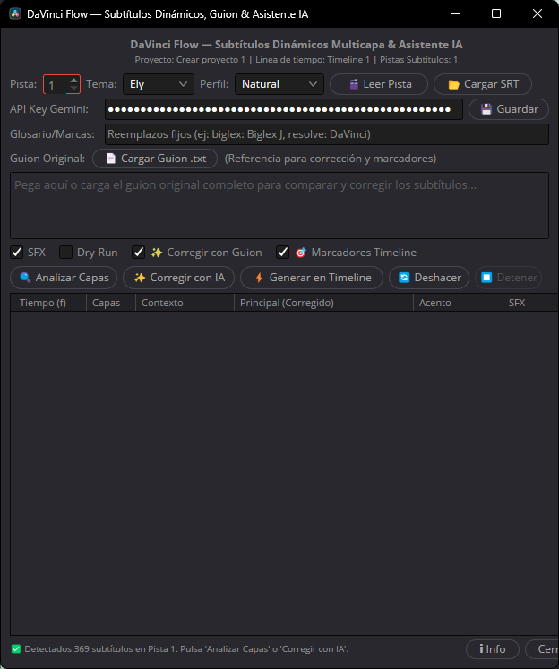

# DaVinci Flow

En `main`, `mise dev` abre DaVinci Flow en Rust + GPUI. `mise dev py` abre la edición Python/Flet de la rama `Python` en su propia carpeta de trabajo. Si todavía no existe, el comando la prepara junto al repositorio. El código Rust vive en `src-gpui/` y sus adaptadores usan el motor de `src/davinci_flow/`. [Guía de GPUI](src-gpui/README.md).

DaVinci Flow es una aplicación para automatizar la edición en DaVinci Resolve 21. Su flujo editorial va de la transcripción a la propuesta, la revisión y la aplicación de títulos Text+ editables. Luna Fetch incorpora medios al Media Pool.

El [catálogo visual y los presets](docs/es/guides/catalogo-y-presets-textplus.md) permiten consultar títulos instalados, reproducir sus muestras originales disponibles y guardar selecciones reutilizables. La escritura editorial utiliza bases DRB o del Media Pool; los SETTING/DRFX sin base nativa se detienen antes de escribir. La validación real de la nueva colección editorial sigue pendiente.

## 📸 Capturas de Pantalla



## Organización de recursos

El icono canónico de identidad se conserva en [`assets/branding/icons/icon-transparent.png`](assets/branding/icons/icon-transparent.png). Los recursos derivados deben generarse desde esa fuente conforme al [Asset Organization Standard](../Docs/global/architecture/asset-organization-standard.md); las capturas documentales viven en `docs/screenshots/`.

---

## 🚀 Capacidades Principales

- **Transcripción como fuente de verdad**: Lee la pista nativa o un SRT; las capas son un resultado del análisis, no la entrada.
- **Clasificación semántica determinista**: Desglose en hasta 3 capas de texto (`DF_CONTEXT`, `DF_MAIN`, `DF_ACCENT`) e intención comunicativa (`statement`, `question`, `exclamation`, `emphasis`, `negation`).
- **Brand Guard y temas oficiales**: Soporte estricto para los temas **Ely** y **Aurora** con validación de paletas HEX y fuentes tipográficas oficiales.
- **Títulos editoriales nativos**: Copia bases DRB/Media Pool y verifica pista, inicio, duración y texto, conservando su diseño. La validación completa de la nueva colección en Resolve sigue pendiente.
- **Proveedores de IA intercambiables**: Capa `ai/providers` con adaptadores de **Google Gemini** y **Minimax** tras un contrato común; el proveedor se elige en Ajustes.
- **Generación de voz**: Sección independiente reservada para el servicio de Aurora con Gemini. La integración está pendiente; la interfaz anterior de locución con Minimax se ha retirado.
- **Autocorrector auditable**: Normalización, glosario e IA por etapas separadas, con el diff de cada subtítulo.
- **Efectos Fusion editables**: Composiciones y títulos nativos (`Text+`, `Fade On`, `Headline`) que se siguen editando en el Inspector, nunca renderizados.
- **Subtítulos en la pista nativa**: Escritura de cues en la pista `subtitle` de Resolve, con verificación posterior.
- **DaVinci Flow como herramienta MCP**: Las mismas operaciones publicadas como herramientas MCP para que cualquier agente pueda operarlo ([guía](docs/MCP_SERVIDOR.md)).
- **Motor SFX funcional**: Propone y materializa WAV originales de DaVinci Flow, con control de densidad y soporte para `[SFX_OFF]`.
- **Idempotencia**: Un mismo plan reutiliza sus clips identificados en vez de duplicarlos.
- **Reversión selectiva**: El botón Deshacer retira únicamente la última ejecución registrada; no vacía todas las pistas DF.

---

## 🏛️ Arquitectura Modular

El mapa completo de módulos, contratos y rutas de configuración está en [`docs/arquitectura.md`](docs/arquitectura.md).

```text
src/davinci_flow/
├── __main__.py              Entrada CLI principal (planificación, generación, auditoría)
├── application.py           Coordinación de casos de uso del producto
├── errors.py                Jerarquía de errores controlados
├── mcp_server.py            Servidor MCP que publica el producto como herramientas
├── ai/                      Integraciones con proveedores de IA
│   ├── client.py            Cliente de Google Gemini (histórico, sin cambios de contrato)
│   ├── credentials.py       Claves por proveedor en ~/.davinci_flow/config.json
│   ├── http.py              Reintentos, saneado de errores y extracción de JSON
│   └── providers/           Contrato TextProvider + adaptadores Gemini y Minimax
├── voice/                   Locución sintética
│   └── tts.py               Cliente Minimax t2a_v2, voces de la cuenta y subtítulos alineados
├── generation/              Plan de generación, diffs, plantillas Fusion y registros
│   ├── fusion_template.py   Generador de composiciones Fusion y conversión de color
│   ├── carrier_media.py     AVI mínimo para duración exacta de composiciones Fusion
│   ├── plan.py              Modelo GenerationPlan versionado (1.0.0) y persistencia
│   ├── reconciler.py        Motor de reconciliación y diff de subtítulos
│   └── record.py            Auditoría de clips generados y reversión
├── resolve/                 Adaptadores exclusivos para DaVinci Resolve API
│   ├── client.py            Conexión segura y detección de sesión
│   ├── subtitle_reader.py   Lector y normalizador de pistas
│   ├── subtitle_writer.py   Escritura en la pista nativa de subtítulos
│   ├── fusion_effects.py    Composiciones Fusion y títulos nativos editables
│   ├── timeline_writer.py   Inserción y reversión en pistas dedicadas
│   └── track_manager.py     Gestión de pistas DF_CONTEXT, DF_MAIN, DF_ACCENT, DF_SFX
├── sfx/                     Biblioteca y motor de efectos de sonido
│   ├── catalog.py           Descriptor auditable AssetDescriptor y catálogo
│   ├── assets.py            Materialización de WAV procedurales incluidos
│   └── engine.py            Motor de propuesta y perfiles de densidad
├── subtitles/               Modelos de dominio, normalizador y clasificador
│   ├── block.py             CaptionBlock con roles y trazabilidad
│   ├── classifier.py        Clasificador de capas semánticas en español
│   ├── fingerprint.py       Huellas SHA-256 e identificadores estables
│   ├── model.py             SubtitleCue nativo
│   ├── autocorrect.py       Autocorrector por etapas con diff auditable
│   └── normalizer.py        Normalizador ortográfico y de caracteres especiales
└── themes/                  Tokens oficiales y Brand Guard
    └── tokens.py            ThemeTokens, temas Ely/Aurora y validación estricta
```

---

## 🛠️ Requisitos del Entorno

- **Sistema Operativo**: Windows 11 (64 bits).
- **Entorno Host recomendado**: DaVinci Resolve Studio 21.1, con su MCP oficial instalado.
- **Interfaz de escritorio**: Flet 0.86.5 sobre CPython 3.13 de 64 bits, gestionado con uv.
- **Puente editorial**: MCP oficial de Blackmagic por stdin/stdout. Las operaciones se ejecutan en el Python integrado de Resolve y devuelven datos JSON; DaVinci Flow no carga su DLL en este recorrido.
- **Compatibilidad**: el auxiliar CPython 3.13 anterior sigue disponible para instalaciones compatibles con scripting externo. Los comandos clásicos de planificación/generación de la CLI conservan ese adaptador.
- **Dependencias**: Flet y su cliente Flutter para la interfaz; el cliente MCP utiliza únicamente la biblioteca estándar.

### Operación con Mise (Estándar Ecosistema)

DaVinci Flow implementa la interfaz universal de tareas mediante Mise:

| Tarea | Propósito |
|---|---|
| `mise setup` | Preparar `.venv` con `uv` e instalar el lanzador en DaVinci Resolve. |
| `mise dev` | Abrir la interfaz nativa Rust + GPUI. |
| `mise dev py` | Abrir Python/Flet en su carpeta de trabajo. |
| `mise build` | Verificar sintaxis y generar los paquetes Python en `dist/`, sin instalador. |
| `mise check` | Verificar sintaxis, importación y contratos de los scripts, sin artefactos. |
| `mise test` | Ejecutar las pruebas unitarias. |
| `mise release` | Generar el instalador de Windows en `release/` y los paquetes Python en `dist/`, sin publicar. |
| `mise publish` | Publicar la release en GitHub Releases; exige autorización explícita (`--yes`). |

Opciones de inspección y comprobación:
- `--plan`: Muestra el comando y las operaciones planificadas sin ejecutar procesos ni modificar el sistema (`mise dev --plan`, `mise release --plan`, `mise publish --plan`).
- `--check`: (para `publish`) Verifica el estado del repositorio, tags, notas y la presencia e integridad del instalador en `release/` sin publicar nada (`mise publish --check`).
- `--yes`: (para `publish`) Autoriza de forma explícita la publicación en GitHub Releases (`mise publish --yes`). Sin esta opción la tarea no publica y muestra el plan.

La publicación usa GitHub Releases como fuente de distribución. La sincronización de la ficha del producto en Aurora no está automatizada en este repositorio y se realiza por el canal administrativo descrito en el [estándar de release message web](../Docs/global/releases/web-release-message-standard.md).

### Preparar y abrir la interfaz (Método Directo)

```powershell
mise setup     # equivalente a ./scripts/setup-desktop.ps1
mise dev       # Rust + GPUI
mise dev py    # Python/Flet
```

La preparación utiliza `.venv` y actualiza el acceso **Área de trabajo → Secuencias de comandos → DaVinci Flow**. El menú de Resolve, `--ui` y `--editorial-ui` abren la misma ventana Flet; una segunda apertura trae la primera al frente.

El editor, las plantillas, la biblioteca por categorías y los ajustes comparten ventana. La captura, el catálogo del Media Pool, la aplicación revisada y Deshacer detectan automáticamente el MCP oficial. La propuesta sigue requiriendo revisión antes de aplicar. No hay un servidor de red ni reintentos automáticos de escrituras.

Consulta la [guía del puente MCP](docs/es/guides/puente-mcp-resolve.md) para elegir transporte, diagnosticar la conexión y conocer el límite de 60 segundos por script. El puente no cambia el proveedor de IA ni elimina la revisión editorial. La integración no demuestra por sí sola una mejora de FPS o consumo de memoria.

La biblioteca comparte únicamente nombres de los recursos elegidos con la IA. La inserción editorial de visuals, música y las dos capas de SFX sigue en las fases siguientes. Consulta la [validación de la migración](process/active/2026-09-07_interfaz-flet/VALIDATION.md).

---

## 🔌 DaVinci Flow como herramienta MCP

Además de la interfaz, DaVinci Flow publica sus operaciones como un **servidor MCP por stdio**. Así cualquier agente puede capturar subtítulos, generar una propuesta, aplicarla revisada, insertar títulos nativos, crear efectos Fusion editables, generar voz, autocorregir y escribir en la pista nativa sin depender de la ventana abierta.

```powershell
$env:PYTHONPATH = "$PWD\src"
uv run --python 3.13 python -m davinci_flow.mcp_server
```

La propuesta sigue exigiendo revisión explícita (`reviewed: true`) antes de aplicarse, y una escritura que Resolve no confirma no se reintenta a ciegas. Consulta la [guía del servidor MCP](docs/MCP_SERVIDOR.md) para el registro en un cliente y el catálogo completo de herramientas.

---

## 📖 Guía de Uso por Terminal

Configurar la ruta del paquete:

```powershell
$env:PYTHONPATH = "$PWD\src"
```

### 1. Información y Acerca de
```powershell
uv run --python 3.13 python -m davinci_flow --about
```

### 2. Previsualizar el Plan de Capas (Modo Seco)
```powershell
uv run --python 3.13 python -m davinci_flow --plan --track 1 --theme ely --profile natural
```

### 3. Exportar el Plan Calculado a Archivo JSON
```powershell
uv run --python 3.13 python -m davinci_flow --plan --export-plan "temp/plan_generacion.json"
```

### 4. Simulación de Generación (Dry-Run)
```powershell
uv run --python 3.13 python -m davinci_flow --generate --dry-run --theme ely
```

También puedes previsualizar un plan directamente desde un archivo SRT **sin necesidad de tener DaVinci Resolve abierto**:
```powershell
uv run --python 3.13 python -m davinci_flow --generate --dry-run --srt "temp/demo.srt" --theme ely
```

### 5. Comparar y Reconciliar contra un Plan Previo
```powershell
uv run --python 3.13 python -m davinci_flow --reconcile "temp/plan_generacion.json"
```

### 6. Experimento: Gemini Decision 1 frente al motor actual
```powershell
uv run --python 3.13 python -m davinci_flow --experiment decision1 --srt "temp/demo.srt" --compare --experiment-out "temp/experimento.json"
```

Compara el motor de decisiones `gemini-decision-1` con el motor editorial
actual sobre el mismo SRT: latencia, consumo, acuerdo por bloque y
cumplimiento del contrato. Guarda el informe y una **propuesta sin revisar**
que se abre en el Editor para revisarla a mano. No escribe en Resolve.

---

## 🧪 Ejecución de Pruebas Automatizadas

```powershell
mise test
```

Equivalente directo:

```powershell
$env:PYTHONPATH = "$PWD\src"
uv run --python 3.13 python -m unittest discover -s tests -v
```

La validación del 21 de agosto de 2026 leyó 369 subtítulos reales de `Timeline 1` y comprobó una muestra reversible de tres capas Fusion más un SFX. Esta evidencia no sustituye la revisión visual y auditiva de Biglex antes de generar toda la línea de tiempo.

---

## 👤 Autor y Licencia

- **Autor**: biglexj (2026)
- **Licencia**: MIT
- **Donaciones Oficiales**: [https://www.biglexj.com/donaciones](https://www.biglexj.com/donaciones)
- **Buy Me a Coffee**: [https://buymeacoffee.com/biglexj](https://buymeacoffee.com/biglexj)
- **GitHub**: [https://github.com/biglexj](https://github.com/biglexj)
